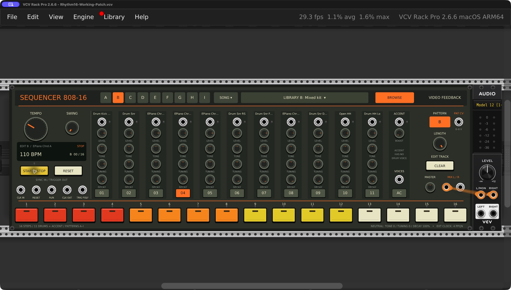
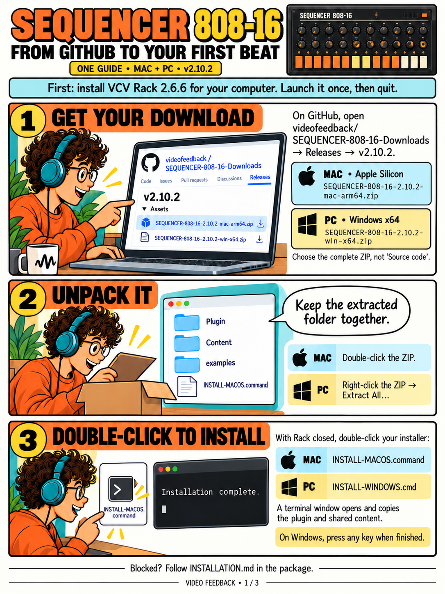
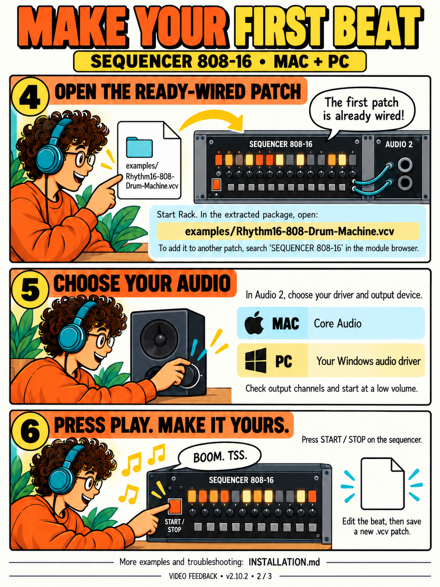
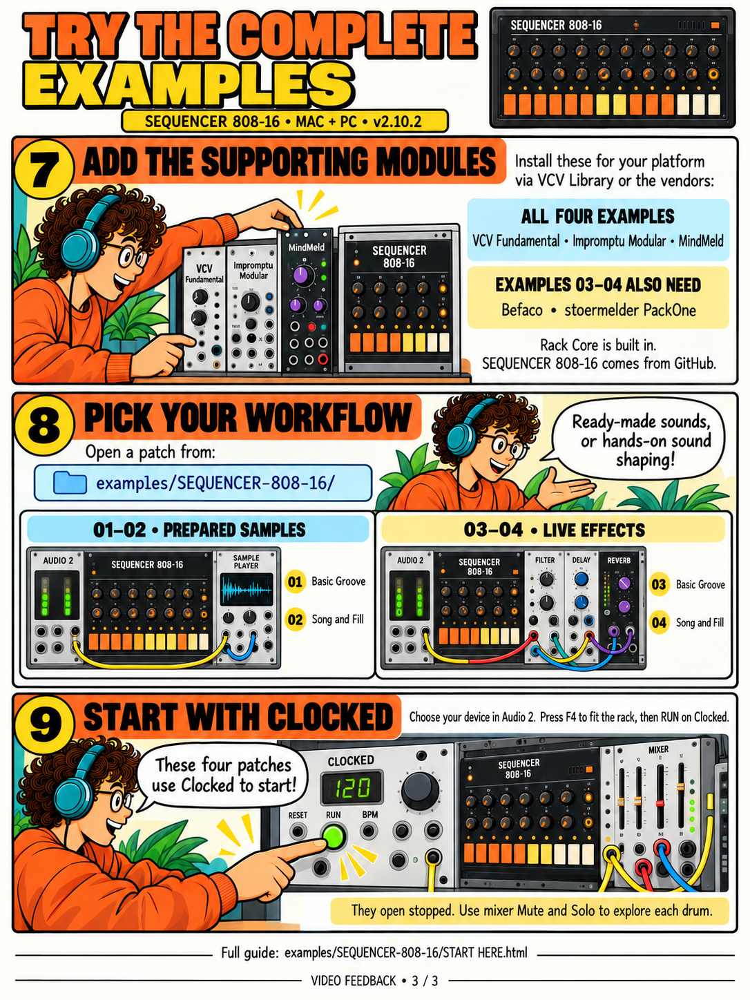

# SEQUENCER 808-16

A free sample-based drum machine and song sequencer for VCV Rack 2. **Mac Apple Silicon (ARM64) and Windows PC (x64).**

*Working Song uses personal SP404 sample kits; those samples are not included in the public download.*

## Download

**[Mac complete package](https://github.com/videofeedback/SEQUENCER-808-16-Downloads/releases/download/v2.10.2/SEQUENCER-808-16-2.10.2-mac-arm64.zip)** · **[Windows complete package](https://github.com/videofeedback/SEQUENCER-808-16-Downloads/releases/download/v2.10.2/SEQUENCER-808-16-2.10.2-win-x64.zip)**

[Examples + installation comic](https://github.com/videofeedback/SEQUENCER-808-16-Downloads/releases/download/v2.10.2/SEQUENCER-808-16-2.10.2-Examples-and-Comic.zip) · [All release files and checksums](https://github.com/videofeedback/SEQUENCER-808-16-Downloads/releases/tag/v2.10.2)

Version **2.10.2 is a pre-release**, targeting Rack 2.6.6. Intel Mac, Windows ARM64 and Linux packages are not included. Choose the complete platform ZIP, not GitHub's automatic Source code archive.

## Installation

1. Install matching VCV Rack, open it once, then quit.
2. Extract your complete platform ZIP.
3. Double-click **INSTALL-MACOS.command** on Mac or **INSTALL-WINDOWS.cmd** on PC; follow the terminal instructions.
4. Reopen Rack and search for **SEQUENCER 808-16**, by **Video Feedback**.

If the OS blocks installation, use the manual steps in [INSTALLATION.md](INSTALLATION.md). The Mac build is not notarized. This plugin is distributed independently of the VCV Library.

### The Mac + PC comic guide

<table><tr>
<td> 1. Install</td>
<td> 2. Your first beat</td>
<td> 3. Complete examples</td>
</tr></table>

[Download the three-page comic PDF](comics/SEQUENCER-808-16-v2.10.2-Mac-PC-Install-Comic.pdf)

## Try the complete examples

The simple `examples/Rhythm16-808-Drum-Machine.vcv` uses this plugin plus Rack Core. Choose Audio 2's output, then press the sequencer's **START / STOP**.

The four patches in [examples/SEQUENCER-808-16](examples/SEQUENCER-808-16) offer prepared samples or visible modular effects, each with Basic Groove (110 BPM) and Song and Fill (118 BPM). They require **VCV Fundamental, Impromptu Modular, MindMeld and Rack Core**; examples 03/04 also require **Befaco Percall and stoermelder PackOne GLUE**. Select Audio 2's device, press F4 to fit, then **RUN on Clocked**. Save the whole .vcv patch to preserve the complete setup.

[Module manual](MANUAL.md) · [Content inventory](CONTENT.md) · [Patchstorage page](https://patchstorage.com/sequencer-808-16-drum-machine-examples-mac-pc/)

## License and support

**Closed-source proprietary freeware.** The source code is private. This public repository contains only downloads, documentation, comics and examples, with no development history. Free for personal and commercial music production; redistribution and code reuse require permission. See [LICENSE.txt](LICENSE.txt). Third-party material retains its own terms.

Original TR-808 recordings: Michael Fischer / Technopolis, 1994. Not affiliated with Roland or VCV. Support: admin@comfycode.ai.
